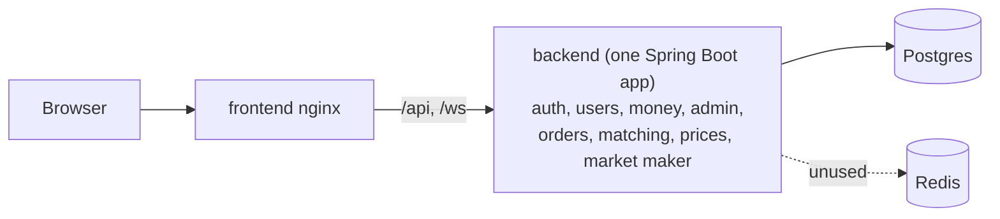
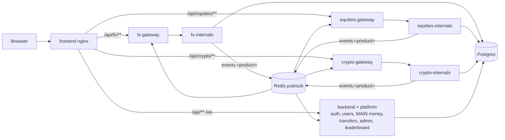
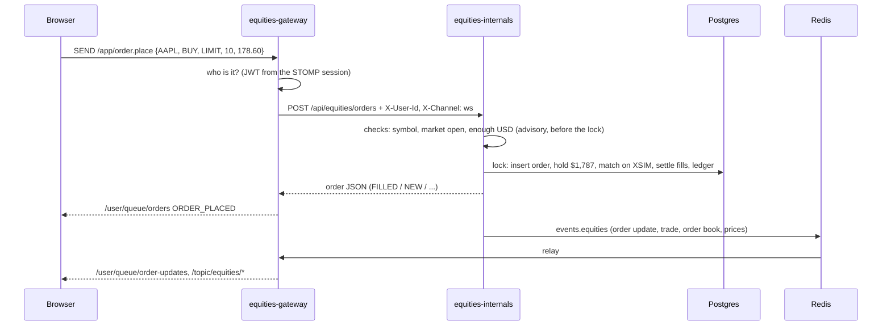

# VulnTrade architecture (1.0.0)

VulnTrade 1.0.0 splits the trading platform into **one domain per financial product**. Each product
has its own **trading gateway** (the front door) and its own **internals** service (the business
logic). Everything that is about the user and their money stays in the **platform**.

```
Financial product  ->  Trading gateway  ->  Internals
FX                     fx-gateway           fx-internals        (dealer: we make the price)
Equities               equities-gateway     equities-internals  (broker: a simulated exchange)
Crypto                 crypto-gateway       crypto-internals    (exchange: our own order book)
```

> This is an **intentionally vulnerable** lab. Every documented vulnerability of 0.6.0 is kept, and
> 20 new product vulnerabilities come with the new domains ([vulnerabilities.md](vulnerabilities.md)).

---

## Before and after

**0.6.0** - one backend did everything:



**1.0.0** - one gateway + one internals service per product:



---

## The services

| Kubernetes name | Code (`backend/`) | What it does |
|---|---|---|
| `backend` (the platform) | `platform` | Login/register, users, the **MAIN** account (deposit/withdraw), **transfers** between your accounts, admin (halt, resume, set price are passed on to the owning product), leaderboard, export, debug, price alerts. Owns the database schema and seeding. Its `/ws` WebSocket keeps the account/admin/alert/history messages. |
| `fx-gateway`, `equities-gateway`, `crypto-gateway` | `gateway` (one codebase, `PRODUCT` env) | The front door of one product. Checks who you are (same JWT / API-key rules as the platform), then passes `/api/<product>/**` to the internals service with `X-User-Id`, `X-Username`, `X-Role`, `X-Request-Id`, `X-Forwarded-For`, `User-Agent`, `X-Channel`. Hosts the product WebSocket `/api/<product>/ws(-sockjs)`: live prices and order updates out (from Redis), orders in (`/app/order.place`, `/app/order.cancel`). No business logic, no database. |
| `fx-internals` | `fx` | **Dealer.** Fake banks (`LpSimulator`) send prices, the `PriceEngine` picks the best one and adds our margin (the spread), clients trade on that quote and **the House** fills every order (`FxOms`, `FxHouse`). |
| `equities-internals` | `equities` | **Broker.** The order management (holds, commission, market session) sends every order to **XSIM**, our one simulated stock exchange: order book, matching, and the house as market maker / liquidity provider. |
| `crypto-internals` | `crypto` | **Exchange.** Our own order book and matching engine. Clients trade with each other and with the house **market-maker bot**. Maker/taker fees. |
| `frontend` | `frontend/` | React app + nginx (routes `/api/<product>/` to the gateways, the rest to the platform). |
| `postgres`, `redis` | - | One shared database; Redis is the event bus. |

All Java services run **the same image** (`vulntrade-backend`); the `SERVICE` environment variable
picks the jar (`/app/platform.jar`, `gateway.jar`, `fx.jar`, `equities.jar`, `crypto.jar`).
`backend/common` is the shared library: entities, repositories, JWT, security logging, the money
helpers (`Accounts`, `Balances`, `Ledger`), the `MatchingCoordinator` and the `EventPublisher`.

---

## Money: one account per product

| Account | Holds | Used by |
|---|---|---|
| **MAIN** | USD (`users.balance`) | deposit, withdraw, admin adjust |
| **FX** | USD, EUR, GBP, JPY (`balances`) | fx-internals |
| **EQUITIES** | USD (`balances`) + shares (`positions`) | equities-internals |
| **CRYPTO** | USD, BTC, ETH, ... (`balances`) | crypto-internals |

- A `balances` row is one account + one asset: **available** (usable now) and **held** (locked for an
  open order). Every change is one atomic SQL statement (`Balances.move`), so parallel requests can
  never overwrite each other.
- **hold -> settle -> release.** Placing a BUY holds the money; each fill pays from the hold first;
  when the order closes (`closeOrder`) the rest of the hold goes back.
- **Transfers** (`POST /api/accounts/transfer`) move USD between your own accounts, in one database
  transaction (safe version: own accounts, amount > 0, only from available money).
- New users get 10,000 USD in MAIN and **10,000 demo USD in each product account**. Seeded users get
  a quarter of their MAIN cash transferred to each product account instead (transfers are not
  capital, so the leaderboard stays as it was).
- The house (user 1) has its own trading money per product (`HOUSE_SEED` ledger rows).
- Every movement is in the ledger (`transactions`) with its `account_id` (NULL = MAIN) and `asset`.

## How an order flows (equities)



FX is the same without the order book: the House fills the order on the quote, instantly.
Crypto is the same with our own matching engine and no house backstop.

## One lock per product

Each internals service serialises its trading with one `MatchingCoordinator` (a fair lock + one
database transaction). In 0.6.0 there was **one global lock** for all symbols because the house was
on the other side of almost every trade. Now each product has its own house account, so FX,
equities and crypto trade in parallel. Each internals service must run as **one replica**.

## Live events

Internals services publish `{destination, user, payload}` to the Redis channel `events.<product>`.
The product gateway forwards each one to its WebSocket clients; the platform listens to the price
ticks to fire price alerts. Delivery is fire-and-forget (a UI notification): the order result
itself always comes back synchronously.

## Ports and paths

| Path (through nginx) | Goes to |
|---|---|
| `/api/fx/**`, `/api/fx/ws-sockjs` | fx-gateway |
| `/api/equities/**`, `/api/equities/ws-sockjs` | equities-gateway |
| `/api/crypto/**`, `/api/crypto/ws-sockjs` | crypto-gateway |
| `/api/**`, `/ws`, `/ws-sockjs`, `/actuator/**`, `/h2-console/**` | backend (platform) |
| `/internal/**` | never routed by nginx: service-to-service calls (gateway -> platform API keys, platform -> internals admin) |

Retired in 1.0.0: `/api/orders*`, `/api/market/*`, STOMP `/app/trade.placeOrder|cancelOrder|executeMarket`,
`/app/market.*`, `/topic/prices`, `/topic/trades`, `/topic/orderbook*` on the platform.

## Running it

- **docker compose:** `docker compose up --build` (all 11 containers; the frontend is on :3001).
- **Kubernetes / minikube:** see [deploy/README.md](../deploy/README.md). 1.0.0 needs a **fresh
  database** (the money model changed): `make reset` before installing over a 0.6.x release.

## Future slots (designed, not built)

| Product | Slot | Where |
|---|---|---|
| FX | A/B-book router: keep the order in the house or pass it to a bank | `FxOms.execute` |
| Equities | Smart order router across several exchanges | `OrderService.route` |
| Crypto | Wallets: deposits/withdrawals on a simulated blockchain | the CRYPTO account |
